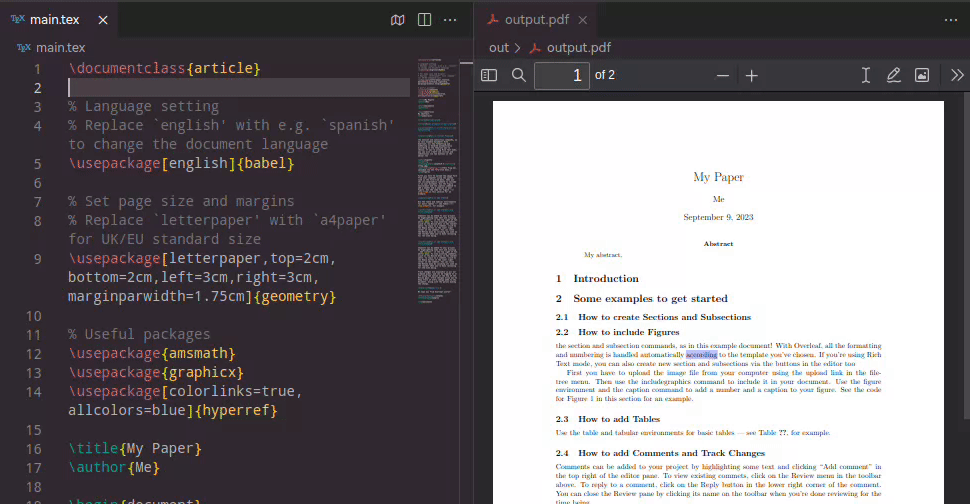
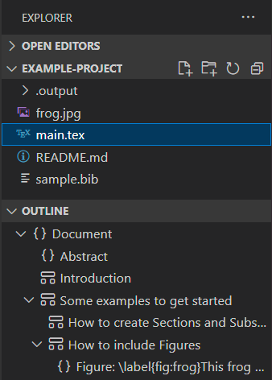
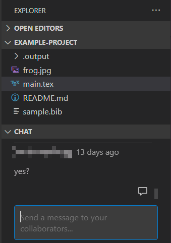

# LeafRelay

**在本地写作，在 Overleaf 协作，让两端保持同步。**

[](https://www.npmjs.com/package/leafrelay)
[](https://marketplace.visualstudio.com/items?itemName=lealaxy.leafrelay-sync)
[](https://github.com/yunhaoli24/leafrelay/actions/workflows/vsce-package.yml)
[](./LICENSE)

[English](./README.md) · [VS Code 上手](#在-vs-code-中开始使用) · [CLI](#脱离-vs-code-运行) · [文档](./docs/README.md) · [下载](https://github.com/yunhaoli24/leafrelay/releases)

LeafRelay 让 **Overleaf 与本地 LaTeX 目录双向同步**。你可以用 VS Code、其他编辑器、终端或 AI 编程工具修改文件，合作者继续在 Overleaf 网页端写作。想要完整写作界面，可以使用 VS Code 扩展；只需要同步文件，也可以直接运行 npm CLI。



## 为什么选择 LeafRelay？

本地写作不应该被同步打断：外部工具修改文件后，不必再去编辑器保存一次；重新打开项目，不必重复下载所有未变化的文件；多人同时修改，也不该悄悄覆盖其中一方的内容。

LeafRelay 在 Overleaf Workshop 的基础上，重构了扩展和 CLI 共用的同步核心：

| 你的使用场景 | LeafRelay 的改进 |
| --- | --- |
| 用其他编辑器、脚本或 AI 工具修改文件 | 通过文件系统事件触发同步，VS Code 切到后台也能继续工作。 |
| 和 Overleaf 网页端的合作者同时写作 | 三方合并自动合并不重叠的文本修改；修改重叠时，暂停对应文件并提供差异查看。 |
| 重新打开一个较大的项目 | 利用已保存的检查点增量同步，避免每次重连都下载所有未变化文件。 |
| 同时打开多个 VS Code 窗口和 CLI | 共用一个 daemon，统一管理连接、监听和上传；同一目录可以被多个客户端附着。 |
| 遇到 Overleaf 请求限流 | 同一账号下的项目共用请求队列，遵守 `429` 冷却时间。 |
| 想知道同步了什么、哪里失败了 | 文件日志显示方向、来源以及行号或字节变化；冲突和失败路径保持可见。 |

**写作功能也保留了下来：**远端编译、PDF 预览与 SyncTeX、LaTeX 补全、文档大纲、项目历史和协作者聊天。

| 按章节导航 LaTeX 文档 | 与合作者交流 |
| --- | --- |
|  |  |

## 在 VS Code 中开始使用

1. 安装 **[LeafRelay Sync](https://marketplace.visualstudio.com/items?itemName=lealaxy.leafrelay-sync)**，扩展 ID 为 `lealaxy.leafrelay-sync`。也可以从 [GitHub Releases](https://github.com/yunhaoli24/leafrelay/releases) 下载 `.vsix`，在扩展面板选择 **… → 从 VSIX 安装…**。
2. 打开 **LeafRelay: Hosts**，点击 **+**，添加 `www.overleaf.com` 或自托管 Overleaf 服务器。使用浏览器 Cookie，或服务器支持的认证方式登录。
3. 选择项目，点击 **Open Project Locally…**，指定本地目录，然后在 VS Code 中打开该目录，即可开始同步。
4. 用你习惯的工具修改文件，在 **输出 → LeafRelay** 查看同步活动。需要生成 PDF 时，使用扩展的编译命令，在 Overleaf 上编译并预览。

已有本地副本时，直接打开含有 `.overleaf/settings.json` 的目录，再登录对应服务器即可；Overleaf Workshop 创建的项目关联也可以继续使用。请停用该目录中的原扩展，避免它另行启动一套独立同步。

## 脱离 VS Code 运行

需要 **Node.js 24 或更高版本**。

```bash
npm install --global leafrelay
leafrelay login https://www.overleaf.com
cd /path/to/local-replica
leafrelay serve
```

`login` 会交互式询问使用浏览器 Cookie 还是邮箱和密码。对于 `www.overleaf.com`，可以从已登录的浏览器获取会话 Cookie。登录状态保存在 `~/.leafrelay/config.json`，与 VS Code 扩展共用。

`serve` 读取当前目录的 **`.overleaf/settings.json`**，不会自动创建项目关联。先通过扩展的 **Open Project Locally…** 配置一次本地目录，之后就可以单独用终端运行。也可以直接指定目录：

```bash
leafrelay serve /path/to/local-replica
leafrelay daemon status
```

保持 `serve` 运行即可持续同步，按 **Ctrl+C** 退出当前客户端。CLI 负责文件同步；远端编译与 PDF 查看界面由 VS Code 扩展提供。

## VS Code 和 CLI 同时使用

VS Code 和 CLI 连接同一个本地 daemon，同时打开相同目录时共用一个同步引擎。每个 Overleaf 项目对应一个可写本地目录，不同项目可以并行同步。某个目录的最后一个客户端断开后，该目录立即停止同步，并释放远端连接。

扩展和 CLI 请使用相同的发布版本。运行中的旧 daemon 会自动重启升级；daemon 版本更高时，则提示先升级连接它的客户端。

## 遇到冲突怎么办？

不重叠的文本修改会自动合并。如果两端修改了同一段内容，LeafRelay 只暂停**这个文件**，其他正常文件继续同步。在 VS Code 中选择 **Review Difference（查看差异）**、**Use Local（使用本地）**或 **Use Overleaf（使用远端）**。解决一个后会继续处理下一个；有多个冲突时，也可以批量选择冲突路径的处理方向。

点号开头的路径，如 `.git`、`.output`，以及软链接不会参与同步。需要同步的正文和素材请放在普通目录中。

## 文档与参与开发

- [用户指南](./docs/README.md)：项目管理、编译、协作与设置。
- [CLI 与项目架构](./docs/anatomy.md)：配置位置、共享 daemon 和模块划分。
- [贡献指南](./CONTRIBUTING.md)：开发环境、Oxc 工具链、测试与发布流程。
- [问题反馈与功能建议](https://github.com/yunhaoli24/leafrelay/issues)。

```bash
corepack enable
pnpm install --frozen-lockfile
pnpm run compile
pnpm test
```

Pull Request 在打包前会运行 Vitest、跨平台 IPC 测试、真实 VS Code Extension Host 测试和 ShareLaTeX 容器集成测试。

## 致谢

LeafRelay 是独立维护的 [Overleaf Workshop](https://github.com/overleaf-workshop/Overleaf-Workshop) 分支，采用 [AGPL-3.0-only](./LICENSE) 许可证。上方编辑器截图改编自原项目的示例演示，感谢原作者与贡献者打下的基础。LeafRelay 与 Overleaf 没有隶属关系。
